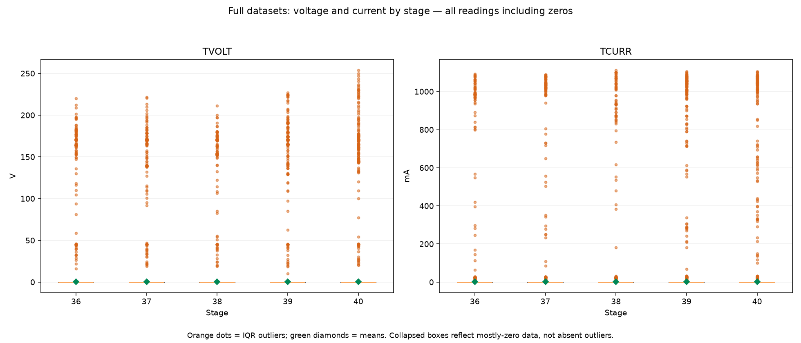

# Full-dataset voltage and current box plots

All stage readings are included; no depth or activity filter is applied. Outliers lie below Q1 − 1.5×IQR or above Q3 + 1.5×IQR. The mean is not a threshold.

| Stage | Sensor | Mean | Median | IQR lower fence | IQR upper fence | Outlier rows |
| --- | --- | --- | --- | --- | --- | --- |
| 36 | TVOLT | 0.2853 | 0.00 | 0.00 | 0.00 | 139 |
| 36 | TCURR | 0.9367 | 0.00 | 0.00 | 0.00 | 133 |
| 37 | TVOLT | 0.4449 | 0.00 | 0.00 | 0.00 | 147 |
| 37 | TCURR | 1.6306 | 0.00 | 0.00 | 0.00 | 146 |
| 38 | TVOLT | 0.3833 | 0.00 | 0.00 | 0.00 | 143 |
| 38 | TCURR | 1.2820 | 0.00 | 0.00 | 0.00 | 141 |
| 39 | TVOLT | 0.4432 | 0.00 | 0.00 | 0.00 | 188 |
| 39 | TCURR | 1.8455 | 0.00 | 0.00 | 0.00 | 188 |
| 40 | TVOLT | 0.4355 | 0.00 | 0.00 | 0.00 | 205 |
| 40 | TCURR | 1.6804 | 0.00 | 0.00 | 0.00 | 202 |

Some distributions have IQR = 0 because readings are mostly zero. Their box-plot fences collapse to zero: both a small nonzero reading and a large spike can therefore be IQR outliers. This does not establish a firing threshold or a normal range while the panel is energized.

