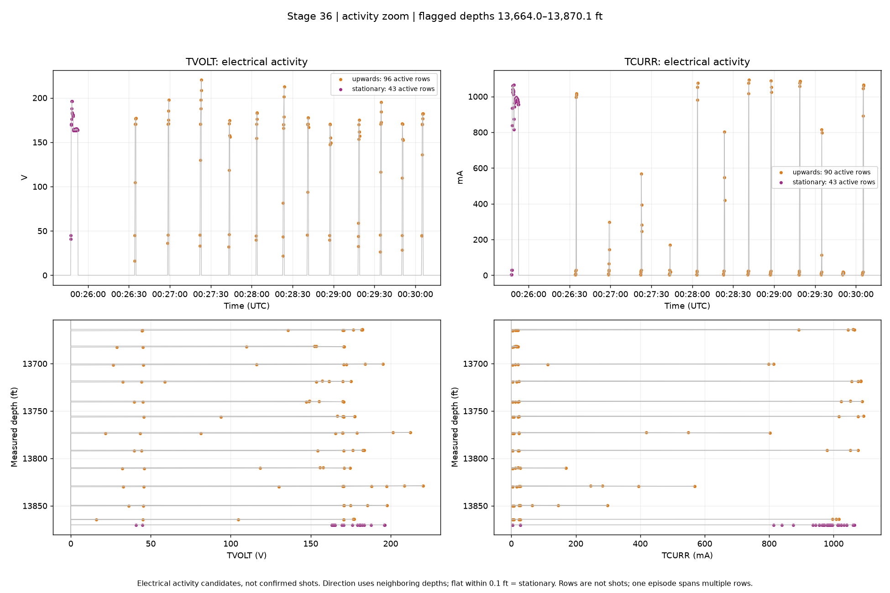

| Stage | Channel | Spikes (nonzero episodes) | Downward starts | Upward starts | Stationary starts | Unclear starts |
| --- | --- | --- | --- | --- | --- | --- |
| 36 | TVOLT | 13 | 0 | 12 | 1 | 0 |
| 36 | TCURR | 18 | 0 | 17 | 1 | 0 |
| 37 | TVOLT | 13 | 0 | 12 | 1 | 0 |
| 37 | TCURR | 13 | 0 | 12 | 1 | 0 |
| 38 | TVOLT | 13 | 0 | 12 | 1 | 0 |
| 38 | TCURR | 14 | 0 | 13 | 1 | 0 |
| 39 | TVOLT | 12 | 0 | 11 | 1 | 0 |
| 39 | TCURR | 12 | 0 | 11 | 1 | 0 |
| 40 | TVOLT | 13 | 0 | 12 | 1 | 0 |
| 40 | TCURR | 13 | 0 | 12 | 1 | 0 |

| Stage | Channel | First flagged time (UTC) | Depth (ft) | Last flagged time (UTC) | Depth (ft) |
| --- | --- | --- | --- | --- | --- |
| 36 | TVOLT | 2025-09-09T00:25:47.379+00:00 | 13870.1 | 2025-09-09T00:30:05.605+00:00 | 13664.0 |
| 36 | TCURR | 2025-09-09T00:25:47.379+00:00 | 13870.1 | 2025-09-09T00:30:05.605+00:00 | 13664.0 |
| 37 | TVOLT | 2025-09-09T04:48:00.666+00:00 | 13627.0 | 2025-09-09T04:51:51.008+00:00 | 13431.1 |
| 37 | TCURR | 2025-09-09T04:48:00.666+00:00 | 13627.0 | 2025-09-09T04:51:51.008+00:00 | 13431.1 |
| 38 | TVOLT | 2025-09-09T09:36:06.144+00:00 | 13396.0 | 2025-09-09T09:40:01.939+00:00 | 13189.7 |
| 38 | TCURR | 2025-09-09T09:36:06.144+00:00 | 13396.0 | 2025-09-09T09:40:01.939+00:00 | 13189.7 |
| 39 | TVOLT | 2025-09-09T13:54:54.786+00:00 | 13159.0 | 2025-09-09T13:59:01.207+00:00 | 12950.8 |
| 39 | TCURR | 2025-09-09T13:54:54.786+00:00 | 13159.0 | 2025-09-09T13:59:01.207+00:00 | 12950.8 |
| 40 | TVOLT | 2025-09-09T18:19:44.860+00:00 | 12921.2 | 2025-09-09T18:23:22.655+00:00 | 12714.2 |
| 40 | TCURR | 2025-09-09T18:19:44.860+00:00 | 12921.2 | 2025-09-09T18:23:22.655+00:00 | 12714.2 |

Candidate pattern: voltage and current depart from zero together. Example: stage 36, 2025-09-09T00:25:47.379+00:00, 13870.1 ft; that episode peaks at 196.3 V and 1064.4 mA. Electrical spikes are candidates, not confirmed shots.

